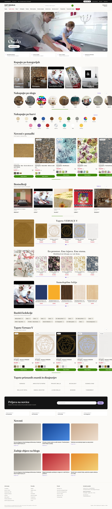

# Svet Dekorja – shop + admin


```
server/   Express + SQLite API (port 4000): login, products/categories/blog/attributes CRUD, page layout, uploads
admin/    React admin panel (dev: 5174, served at /admin)
src/      React storefront (dev: 5173) – reads everything from the API
public/products.json   product export (≈10 800 products) – imported into the database on the FIRST server start
```

## Run (Windows): double-click `start-dev.bat`  (or three terminals: `server`, `admin`, project root: `npm install` + `npm start` / `npm run dev`)
- Shop: http://localhost:5173 · Admin: http://localhost:5174/admin/ · API: http://localhost:4000
- To re-import a new `public/products.json`: stop the server, delete `server/data.db*`, start again. (Admin edits are lost.)
- Admin login is in `server/.env`. Change the password after first login (Admin → Račun).

## Notes on the data
- `price` is treated as the current price; if `specialPrice` is higher it is shown as the crossed-out regular price.
- Category ids → storefront groups (Tapete, Fototapete, …) are defined in `server/index.js` (GROUPS); names were inferred from product names – check/rename.
- Products without `categoryId` are assigned by name (… foto … → Fototapete, … tapet… → Tapete).


